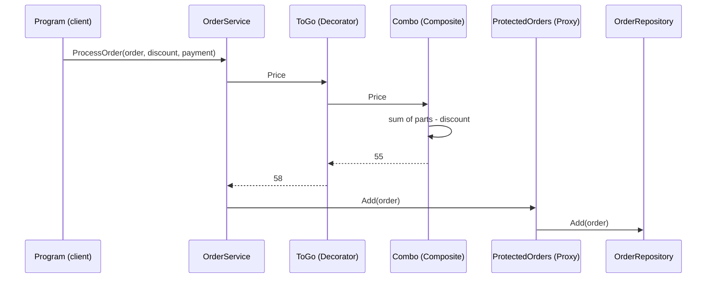
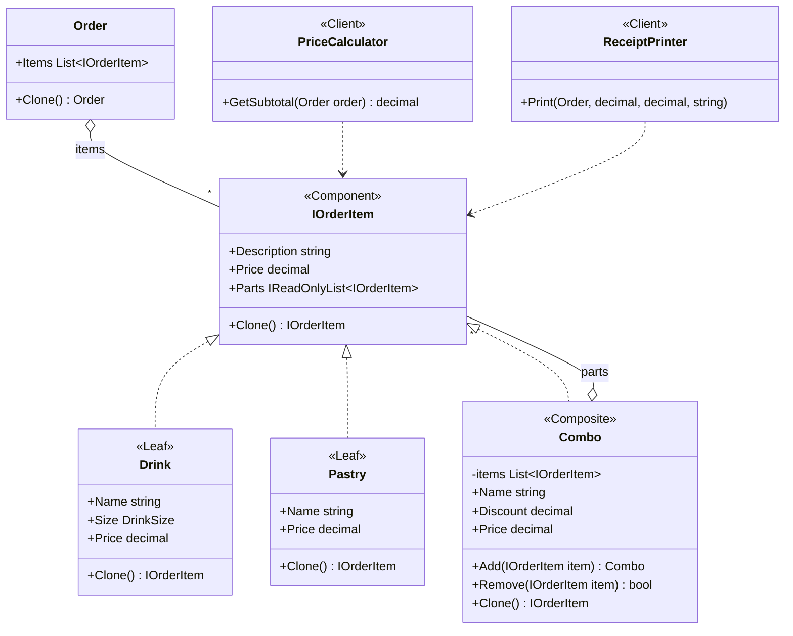
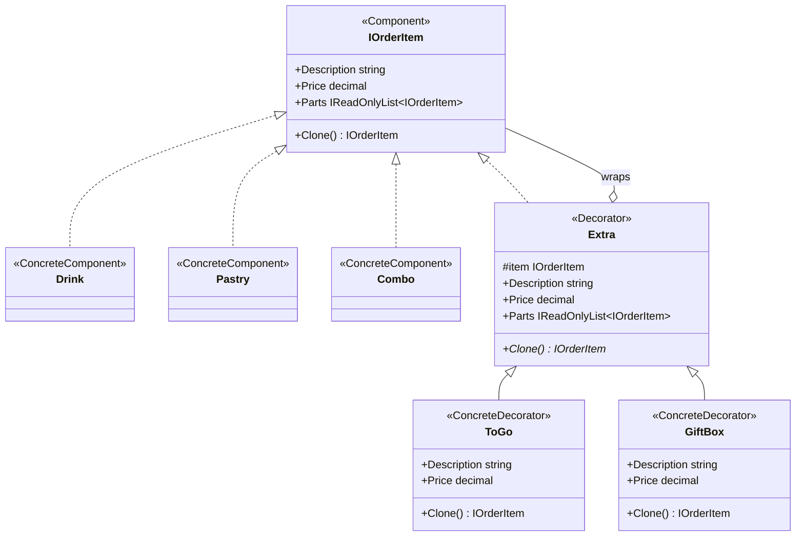
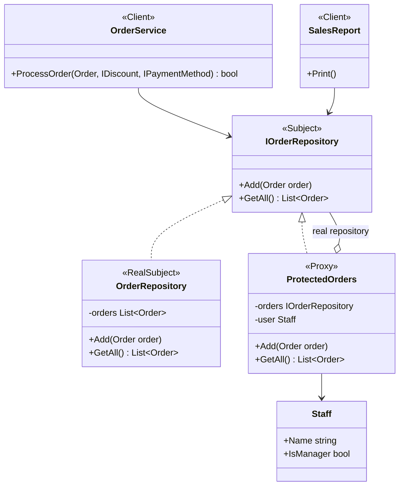

# Structural Design Patterns

## Author: Cătănoi Sergiu, FAF-242

----

## Objectives

* Get familiar with the structural design patterns
* Continue the project from the previous lab and add new features with them
* Implement at least 3 structural patterns that work together

## Used design patterns

* Composite
* Decorator
* Proxy

## Domain description

The app is a small coffee shop (console app in C#). A client makes an order, the program calculates the price, applies a discount, prints a receipt, takes the payment (cash or card) and sends a message to the client. This was already done in lab 0 (SOLID) and lab 1 (Singleton menu, Builder for drinks, Prototype for orders).

In this lab the shop got three new things:

1. **Combos.** The shop sells combos, for example Breakfast = Latte + Croissant with 10 lei off. A client can also get a bigger combo made from other combos (Family = 2 Breakfast combos + a large Tea). An order can have single items and combos mixed.
2. **Extras.** Any item can be taken "to go" (+3 lei for the cup and bag) or put in a gift box (+15 lei). It can be a drink, a pastry or a whole combo, and you can put more extras on the same item.
3. **Sales report.** At the end of the day the manager can see all the orders. A cashier can save orders but should not be able to see all the sales.

How the patterns work together: in `Program.cs` the order of Ana has `new ToGo(menu.Combo("Breakfast"))`. When `OrderService.ProcessOrder` runs, the `PriceCalculator` asks the item for its price, the `ToGo` decorator asks the `Combo`, the combo asks its parts (a `Drink` made by the Builder and a `Pastry`). Then the receipt prints the parts of the combo through the same interface, and at the end the order is saved through `ProtectedOrders`, which lets the cashier save it. So one call goes through all 3 patterns:



The code that uses the patterns works only with interfaces: `OrderService`, `PriceCalculator`, `ReceiptPrinter` know only `IOrderItem` and `IOrderRepository`, they never check if something is a combo or a decorator.

----

## Composite

**Problem:** before this lab an order was a list of drinks. With combos, an order has things that are a single item and things that are a group of items, and a group can have another group inside. If `PriceCalculator` and `ReceiptPrinter` had to check `if (item is Combo)` everywhere, every new kind of item would mean changing them.

**Solution:** everything you can order implements `IOrderItem` (description, price, parts). `Drink` and `Pastry` are leaves (no parts), `Combo` is the composite: it keeps a list of `IOrderItem` and its price is the sum of the parts minus the combo discount. Because a combo is also an `IOrderItem`, a combo can contain another combo.

### Class diagram



(`IOrderItem` is an interface, `<<Component>>` is its role in the pattern.)

### Code

[CoffeeShop/Models/Combo.cs](CoffeeShop/Models/Combo.cs)

```csharp
public class Combo : IOrderItem
{
    private readonly List<IOrderItem> items = new();

    public Combo Add(IOrderItem item)
    {
        items.Add(item);
        return this;
    }

    public string Description => Name + " combo";

    public IReadOnlyList<IOrderItem> Parts => items;

    public decimal Price
    {
        get
        {
            decimal sum = items.Sum(i => i.Price);
            return Math.Max(0, sum - Discount);
        }
    }
    ...
}
```

`Price` just asks every part for its price, and the part can be a drink, a pastry or another combo, the combo doesnt care. The receipt prints the parts the same way ([ReceiptPrinter.cs](CoffeeShop/Services/ReceiptPrinter.cs), `PrintParts` calls itself for `item.Parts`), a leaf just has an empty `Parts` list so there are no type checks.

The combos on the menu are made once in `Program.cs` (drinks with the Builder) and `menu.Combo("Breakfast")` returns `combo.Clone()` (Prototype from lab 1), so every order gets its own copy.

### Unit tests

[CoffeeShop.Tests/ComboTests.cs](CoffeeShop.Tests/ComboTests.cs)

| Test | What it checks |
|---|---|
| `Single_items_and_combos_are_used_through_the_same_interface` | a drink, a pastry and a combo in one `List<IOrderItem>`, the sum of prices is right and all of them work the same way (leaf has 0 parts, combo has 2) |
| `Combo_inside_a_combo_is_priced_from_all_parts` | Family combo with 2 Breakfast combos + cookie costs 55 + 55 + 15 - 12 |
| `Cloned_combo_does_not_share_its_parts` | adding something to a cloned combo does not change the original (deep copy) |

----

## Decorator

**Problem:** "to go" and "gift box" can be added to anything (a latte, a croissant, a combo) and also together. With subclasses I would need `LatteToGo`, `ComboToGo`, `ComboInGiftBoxToGo` and so on, it explodes. And in the Builder I can only add things to drinks, not to combos.

**Solution:** `Extra` is an abstract class that implements `IOrderItem` and keeps the item it wraps. By default it just passes everything to that item. `ToGo` and `GiftBox` extend it and change only the description and the price. Because an extra is also an `IOrderItem`, it can wrap another extra, so they stack at runtime in any combination.

### Class diagram



### Code

[CoffeeShop/Extras/Extra.cs](CoffeeShop/Extras/Extra.cs) and [CoffeeShop/Extras/ToGo.cs](CoffeeShop/Extras/ToGo.cs)

```csharp
public abstract class Extra : IOrderItem
{
    protected readonly IOrderItem item;

    protected Extra(IOrderItem item)
    {
        this.item = item;
    }

    public virtual string Description => item.Description;
    public virtual decimal Price => item.Price;

    public IReadOnlyList<IOrderItem> Parts => item.Parts;

    public abstract IOrderItem Clone();
}

public class ToGo : Extra
{
    public ToGo(IOrderItem item) : base(item) { }

    public override string Description => item.Description + ", to go";
    public override decimal Price => item.Price + 3;

    public override IOrderItem Clone() => new ToGo(item.Clone());
}
```

`ToGo.Price` first asks the wrapped item for its price and then adds 3. The wrapped item can be another extra, so `new GiftBox(new ToGo(menu.Combo("Sweet")))` is 45 + 3 + 15 = 63. A new extra (for example extra napkins) is just one more class that extends `Extra`, nothing else changes.

### Unit tests

[CoffeeShop.Tests/ExtrasTests.cs](CoffeeShop.Tests/ExtrasTests.cs)

| Test | What it checks |
|---|---|
| `Extras_stacked_in_any_order_give_the_same_result` | `ToGo(GiftBox(latte))` and `GiftBox(ToGo(latte))` both cost 58 and both have "to go" and "gift box" in the description |
| `Extra_can_wrap_a_combo_and_keeps_the_parts` | a combo to go costs 55 + 3 and still shows the 2 parts of the combo |
| `Wrapped_item_can_be_cloned_with_its_extras` | cloning a decorated item gives a new object with the same price and description |

----

## Proxy

**Problem:** the orders are saved in `OrderRepository`. The cashier (through `OrderService`) has to save orders, but the list of all orders (how much the shop made today) should be seen only by the manager. I didnt want to put an `if (user.IsManager)` inside `OrderRepository`, because then the repository has 2 jobs (store orders and check access), and I didnt want to put it in `SalesReport` because then every class that reads orders has to remember to check.

**Solution:** `ProtectedOrders` implements the same `IOrderRepository` interface and keeps a reference to the real repository and to the user (`Staff`). `Add` is passed through, `GetAll` is passed through only if the user is a manager, otherwise it throws `UnauthorizedAccessException`. `OrderService` and `SalesReport` get an `IOrderRepository` and dont know if it is the real one or the proxy.

### Class diagram



### Code

[CoffeeShop/Repositories/ProtectedOrders.cs](CoffeeShop/Repositories/ProtectedOrders.cs)

```csharp
public class ProtectedOrders : IOrderRepository
{
    private readonly IOrderRepository orders;
    private readonly Staff user;

    public ProtectedOrders(IOrderRepository orders, Staff user)
    {
        this.orders = orders;
        this.user = user;
    }

    public void Add(Order order) => orders.Add(order);

    public List<Order> GetAll()
    {
        if (!user.IsManager)
            throw new UnauthorizedAccessException(user.Name + " is not a manager, cant see the sales");

        return orders.GetAll();
    }
}
```

The proxy has the same interface as the real repository, so it can be put in its place without changing `OrderService` or `SalesReport`. The access check happens before the call goes to the real object, and if it is allowed the call goes through unchanged.

In `Program.cs`:

```csharp
var service = new OrderService(new ProtectedOrders(allOrders, cashier), ...);
...
new SalesReport(new ProtectedOrders(allOrders, cashier), calculator, output).Print();  // Access denied
new SalesReport(new ProtectedOrders(allOrders, manager), calculator, output).Print();  // prints the sales
```

### Unit tests

[CoffeeShop.Tests/ProtectedOrdersTests.cs](CoffeeShop.Tests/ProtectedOrdersTests.cs)

| Test | What it checks |
|---|---|
| `Cashier_cannot_read_the_orders` | `GetAll()` with a cashier throws `UnauthorizedAccessException` |
| `Manager_gets_exactly_what_the_real_repository_has` | with a manager `GetAll()` returns the same list object as the real repository (passed through unchanged) |
| `Cashier_can_still_save_orders` | `Add()` with a cashier reaches the real repository |

----

## All patterns together

[CoffeeShop.Tests/CheckoutTests.cs](CoffeeShop.Tests/CheckoutTests.cs)

| Test | What it checks |
|---|---|
| `Order_with_a_combo_to_go_is_priced_printed_and_saved_through_the_guard` | an order with `ToGo(Breakfast combo)` goes through `OrderService`: total is 58 lei, the receipt prints the croissant inside the combo, and the order is saved in the real repository through `ProtectedOrders` |

## Tests log

```
> dotnet test --logger "console;verbosity=normal"

Passed CoffeeShop.Tests.ProtectedOrdersTests.Cashier_can_still_save_orders [7 ms]
Passed CoffeeShop.Tests.ProtectedOrdersTests.Cashier_cannot_read_the_orders [< 1 ms]
Passed CoffeeShop.Tests.ExtrasTests.Extras_stacked_in_any_order_give_the_same_result [9 ms]
Passed CoffeeShop.Tests.ProtectedOrdersTests.Manager_gets_exactly_what_the_real_repository_has [< 1 ms]
Passed CoffeeShop.Tests.ExtrasTests.Wrapped_item_can_be_cloned_with_its_extras [< 1 ms]
Passed CoffeeShop.Tests.CheckoutTests.Order_with_a_combo_to_go_is_priced_printed_and_saved_through_the_guard [11 ms]
Passed CoffeeShop.Tests.ExtrasTests.Extra_can_wrap_a_combo_and_keeps_the_parts [1 ms]
Passed CoffeeShop.Tests.ComboTests.Single_items_and_combos_are_used_through_the_same_interface [12 ms]
Passed CoffeeShop.Tests.ComboTests.Combo_inside_a_combo_is_priced_from_all_parts [< 1 ms]
Passed CoffeeShop.Tests.ComboTests.Cloned_combo_does_not_share_its_parts [< 1 ms]

Test Run Successful.
Total tests: 10
     Passed: 10
```

## The other structural patterns (not implemented)

* **Adapter**: makes a class with a different interface work with our interface (for example a bank terminal library that wants the amount in bani would be wrapped in a class that implements `IPaymentMethod`).
* **Bridge**: splits an abstraction and its implementation so both can change separately (for example receipt / barista ticket on one side and console / printer / file on the other).
* **Facade**: one simple class in front of a complicated subsystem (one `Checkout()` that calls menu, pricing, payment, receipt).
* **Flyweight**: shares the common part of many small objects to save memory (for example the same cup label data shared by thousands of cups).

## Conclusions

The hardest part was the receipt for the Composite. At first a combo had a long description with everything inside it in brackets, and for the Family combo it was a very long line. I changed it so every item has `Parts` (a leaf just returns an empty list) and the receipt prints the parts under the combo. This way the receipt still doesnt need to know if an item is a combo.

Another thing was cloning. Lab 1 had `Clone()` on drinks and orders, now an order has any `IOrderItem`, so every item had to be clonable, including the extras (`new ToGo(item.Clone())`) and the combos (clone every part).

What I would do differently: the proxy gets the user in the constructor, so for another user you make another proxy. In a bigger app I would give it something like a session object that knows who is logged in right now. Also the sales report shows prices before discounts, because the order does not remember the final total, that could be saved when the payment goes through.
