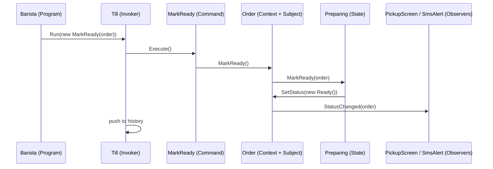
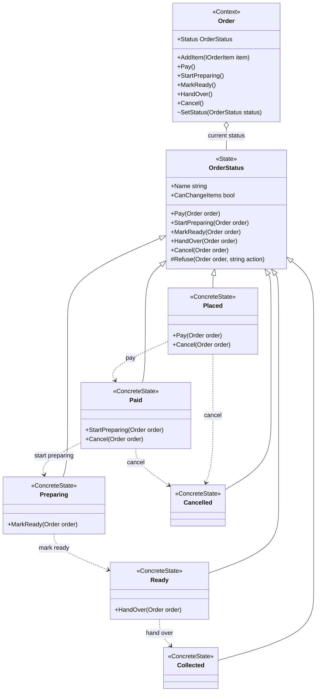
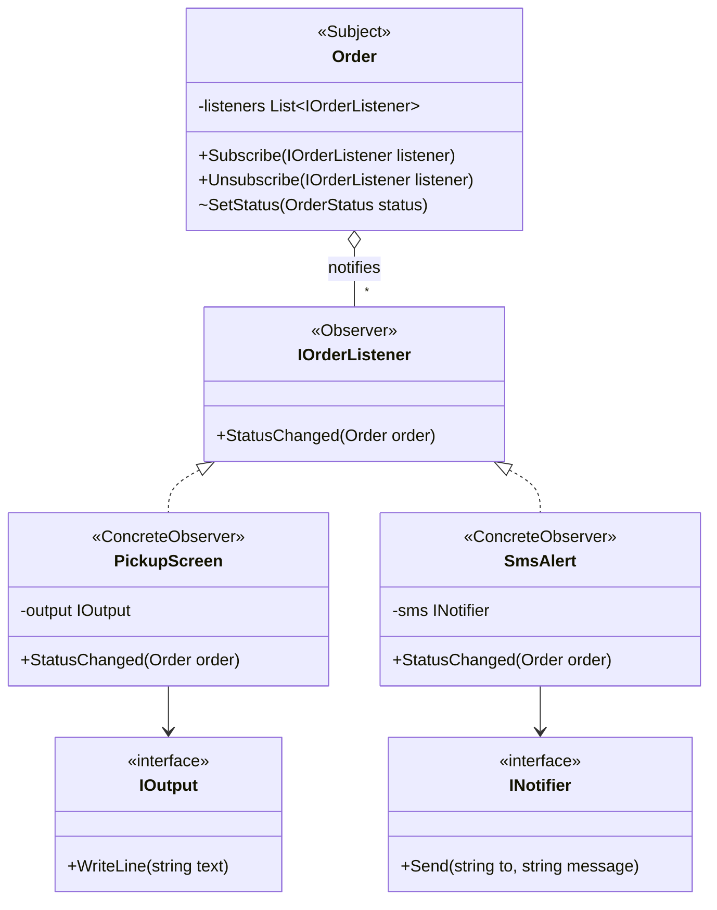
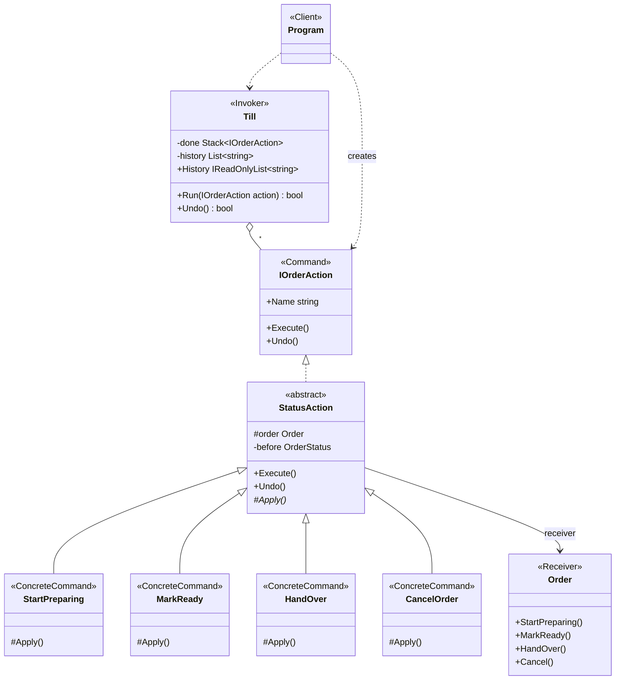

# Behavioral Design Patterns

## Author: Cătănoi Sergiu, FAF-242

----

## Objectives

* Get familiar with the behavioral design patterns
* Think about how the objects in my project talk to each other and use the patterns for that
* Implement at least 3 behavioral patterns that work together, on top of the project from lab 2

## Used design patterns

* State
* Observer
* Command

## Domain description

The app is the coffee shop from the previous labs (C#, console). A client orders drinks, pastries and combos, pays, gets a receipt (lab 0 - lab 2). In this lab I added what happens after the payment:

1. Every order has a **status**: placed → paid → preparing → ready → collected, or cancelled. What you can do with an order depends on the status: you cant give an order to the client before it is ready, you cant add items after paying, you cant cancel an order that is already being made.
2. When the status changes, the **pickup screen** in the shop shows it, and clients who want it get an **SMS** when the order is ready (or cancelled). A client can turn the SMS on and off.
3. The barista uses a **till** with buttons: prepare, ready, give, cancel. The till remembers what was pressed (history) and has an **undo** button for mistakes.

How the patterns work together: the barista presses "ready" → the till runs the `MarkReady` action (Command) → the action calls `order.MarkReady()` → the order asks its current status object what to do, `Preparing` moves it to `Ready` (State) → the order tells all its listeners, the `PickupScreen` prints "READY" and `SmsAlert` sends the SMS (Observer). If the order is not in the right status, the status object refuses and the till doesnt save the action.



It also builds on lab 2: the orders have combos and extras (`new ToGo(menu.Combo("Breakfast"))`), the drinks come from the Builder and the Singleton menu, and the paid orders are saved through `ProtectedOrders`.

Behavior changes at runtime: at the end of the demo the user types the commands (`prepare`, `ready`, `give`, `cancel`, `undo`, `sms on`, `sms off`). Every word creates an action object for the till, so the order moves between statuses depending on what you type, and `sms on` / `sms off` subscribe and unsubscribe the SMS listener while the program runs.

----

## State

**Problem:** with only a `string Status` field I would need a `switch` in every method of `Order` (`if (Status == "paid") ... else if (Status == "preparing") ...`), and every new status means editing all those switches. Also it is easy to forget a check and give an order that is not ready yet.

**Solution:** `OrderStatus` is an abstract class with one method for every action. By default every action is refused (throws `InvalidOperationException`). Each concrete status overrides only the actions that are allowed from it and moves the order to the next status. `Order` (the context) just passes the call to its current status.

| Status | Allowed |
|---|---|
| `Placed` | add items, pay → `Paid`, cancel → `Cancelled` |
| `Paid` | start preparing → `Preparing`, cancel → `Cancelled` |
| `Preparing` | mark ready → `Ready` |
| `Ready` | hand over → `Collected` |
| `Collected`, `Cancelled` | nothing (final) |

### Class diagram



### Code

[CoffeeShop/Statuses/OrderStatus.cs](CoffeeShop/Statuses/OrderStatus.cs), [CoffeeShop/Statuses/Placed.cs](CoffeeShop/Statuses/Placed.cs), [CoffeeShop/Models/Order.cs](CoffeeShop/Models/Order.cs)

```csharp
public abstract class OrderStatus
{
    public abstract string Name { get; }

    public virtual bool CanChangeItems => false;

    public virtual void Pay(Order order) => Refuse(order, "pay");
    public virtual void StartPreparing(Order order) => Refuse(order, "start preparing");
    public virtual void MarkReady(Order order) => Refuse(order, "mark as ready");
    public virtual void HandOver(Order order) => Refuse(order, "hand over");
    public virtual void Cancel(Order order) => Refuse(order, "cancel");

    protected void Refuse(Order order, string action)
    {
        throw new InvalidOperationException($"cant {action} order #{order.Id}, it is {Name}");
    }
    ...
}

public class Placed : OrderStatus
{
    public override string Name => "placed";
    public override bool CanChangeItems => true;

    public override void Pay(Order order) => order.SetStatus(new Paid());

    public override void Cancel(Order order) => order.SetStatus(new Cancelled());
}

// in Order
public void Pay() => Status.Pay(this);
public void StartPreparing() => Status.StartPreparing(this);
```

`Order` has no `if` or `switch` on the status, it calls the same method on whatever status object it has now. The rules of what is allowed and what comes next are inside the status classes. A forbidden move ends in the base class with an exception and the status stays the same.

### Unit tests

[CoffeeShop.Tests/StatusTests.cs](CoffeeShop.Tests/StatusTests.cs)

| Test | What it checks |
|---|---|
| `Order_goes_through_the_normal_flow` | Placed → Paid → Preparing → Ready → Collected, the status type is right after every step |
| `Forbidden_moves_throw_and_the_status_stays_the_same` | marking ready or handing over a placed order throws, cancelling while preparing throws, and the status does not change |
| `Items_can_be_changed_only_before_payment` | `AddItem` after `Pay()` throws and the order keeps 1 item |
| `Cancelled_order_is_final` | a cancelled order cant be paid |

----

## Observer

**Problem:** when an order changes status, more than one thing has to happen: the screen in the shop must show it, some clients want an SMS, and later maybe more (loyalty points, a kitchen printer...). If `Order` called `screen.Show(...)` and `sms.Send(...)` directly, it would depend on all of them, and every new reaction means changing `Order`. In lab 2 `OrderService` sent the message itself.

**Solution:** `IOrderListener` has one method, `StatusChanged(Order order)`. `Order` (the subject) keeps a list of listeners, `Subscribe` / `Unsubscribe` change that list at runtime, and every time the status is set, the order calls all of them. `PickupScreen` prints the new status, `SmsAlert` sends an SMS only when the order is ready or cancelled. `Order` knows only the interface.

### Class diagram



### Code

[CoffeeShop/Models/Order.cs](CoffeeShop/Models/Order.cs) and [CoffeeShop/Listeners/SmsAlert.cs](CoffeeShop/Listeners/SmsAlert.cs)

```csharp
public void Subscribe(IOrderListener listener)
{
    if (!listeners.Contains(listener))
        listeners.Add(listener);
}

public void Unsubscribe(IOrderListener listener) => listeners.Remove(listener);

internal void SetStatus(OrderStatus status)
{
    Status = status;

    foreach (var listener in listeners.ToList())
        listener.StatusChanged(this);
}

public class SmsAlert : IOrderListener
{
    ...
    public void StatusChanged(Order order)
    {
        if (order.Status is Ready)
            sms.Send(order.CustomerName, $"your order #{order.Id} is ready :)");

        else if (order.Status is Cancelled)
            sms.Send(order.CustomerName, $"your order #{order.Id} was cancelled");
    }
}
```

`SetStatus` is the only place where the status changes, so every change (from a status class or from undo) goes through the notify loop. It loops over a copy (`ToList()`) so a listener could unsubscribe while it is being notified. The listeners only read the order, they dont change its status, so there is no loop of updates. A new reaction is a new class that implements `IOrderListener`.

### Unit tests

[CoffeeShop.Tests/ListenerTests.cs](CoffeeShop.Tests/ListenerTests.cs)

| Test | What it checks |
|---|---|
| `Subscribed_listeners_are_notified_and_unsubscribed_ones_are_not` | 2 listeners get "paid", then one unsubscribes and only the other one gets "preparing" |
| `Sms_is_sent_only_when_the_order_is_ready` | no SMS for paid and preparing, exactly one SMS when ready |
| `Subscribing_twice_still_gives_one_message` | the same listener added twice is notified only once |

----

## Command

**Problem:** the barista presses buttons on the till. If a button just called `order.MarkReady()` there would be no way to undo a wrong press and no list of what was done. Also the till (and the part of the program that reads what the user types) would need to know every action.

**Solution:** every button is an object that implements `IOrderAction` (`Execute`, `Undo`, `Name`). `StatusAction` is a base class for actions that change the status: before running it remembers the status the order had, and `Undo` puts that status back. `StartPreparing`, `MarkReady`, `HandOver`, `CancelOrder` only say which method of the order to call. The receiver is `Order`, the real logic stays in the order and its status. `Till` is the invoker: it runs an action, keeps the ones that worked in a stack (for undo) and in a history list, and refused actions are not saved.

### Class diagram



### Code

[CoffeeShop/Actions/StatusAction.cs](CoffeeShop/Actions/StatusAction.cs) and [CoffeeShop/Actions/Till.cs](CoffeeShop/Actions/Till.cs)

```csharp
public void Execute()                      // StatusAction
{
    var old = order.Status;
    Apply();
    before = old;
}

public void Undo()
{
    if (before == null)
        return;

    order.SetStatus(before);
    before = null;
}

public bool Run(IOrderAction action)       // Till
{
    output.WriteLine("till: " + action.Name);
    try
    {
        action.Execute();
    }
    catch (InvalidOperationException e)
    {
        output.WriteLine("  not allowed, " + e.Message);
        return false;
    }

    done.Push(action);
    history.Add(action.Name);
    return true;
}
```

The action saves the old status only after `Apply()` worked, so a refused action has nothing to undo. The till doesnt know what an action does, it only calls `Execute` / `Undo`, so a new button (for example "refund") is just a new class. In `Program.cs` the words the user types are mapped to actions in a dictionary (`["ready"] = o => new MarkReady(o)`), the till itself does not change.

### Unit tests

[CoffeeShop.Tests/TillTests.cs](CoffeeShop.Tests/TillTests.cs)

| Test | What it checks |
|---|---|
| `Undo_brings_back_the_status_from_before` | prepare + ready, then undo twice gives Preparing and then Paid again |
| `Refused_action_is_not_saved_so_there_is_nothing_to_undo` | "ready" on a paid order fails, the history is empty, `Undo()` returns false and the status is still Paid |
| `Action_on_the_till_changes_the_status_and_the_listeners_hear_it` | Command → State → Observer together: after prepare + ready through the till, the order is Ready, the screen shows READY and exactly one SMS was sent |

----

## Other tests (from lab 2, still passing)

[CoffeeShop.Tests/CheckoutTests.cs](CoffeeShop.Tests/CheckoutTests.cs) also checks that a paid order becomes `Paid` and that a failed payment makes it `Cancelled` and it is not saved. `ComboTests`, `ExtrasTests` and `ProtectedOrdersTests` are the same as in lab 2.

## Tests log

```
> dotnet test --logger "console;verbosity=normal"

Passed CoffeeShop.Tests.ProtectedOrdersTests.Cashier_can_still_save_orders [6 ms]
Passed CoffeeShop.Tests.ListenerTests.Sms_is_sent_only_when_the_order_is_ready [5 ms]
Passed CoffeeShop.Tests.StatusTests.Order_goes_through_the_normal_flow [4 ms]
Passed CoffeeShop.Tests.TillTests.Undo_brings_back_the_status_from_before [6 ms]
Passed CoffeeShop.Tests.ProtectedOrdersTests.Cashier_cannot_read_the_orders [< 1 ms]
Passed CoffeeShop.Tests.StatusTests.Items_can_be_changed_only_before_payment [< 1 ms]
Passed CoffeeShop.Tests.TillTests.Refused_action_is_not_saved_so_there_is_nothing_to_undo [< 1 ms]
Passed CoffeeShop.Tests.ProtectedOrdersTests.Manager_gets_exactly_what_the_real_repository_has [< 1 ms]
Passed CoffeeShop.Tests.StatusTests.Cancelled_order_is_final [< 1 ms]
Passed CoffeeShop.Tests.StatusTests.Forbidden_moves_throw_and_the_status_stays_the_same [< 1 ms]
Passed CoffeeShop.Tests.ExtrasTests.Extras_stacked_in_any_order_give_the_same_result [10 ms]
Passed CoffeeShop.Tests.CheckoutTests.Failed_payment_cancels_the_order_and_it_is_not_saved [10 ms]
Passed CoffeeShop.Tests.ExtrasTests.Wrapped_item_can_be_cloned_with_its_extras [< 1 ms]
Passed CoffeeShop.Tests.CheckoutTests.Order_with_a_combo_to_go_is_priced_printed_and_saved_through_the_guard [< 1 ms]
Passed CoffeeShop.Tests.TillTests.Action_on_the_till_changes_the_status_and_the_listeners_hear_it [4 ms]
Passed CoffeeShop.Tests.ListenerTests.Subscribed_listeners_are_notified_and_unsubscribed_ones_are_not [5 ms]
Passed CoffeeShop.Tests.ListenerTests.Subscribing_twice_still_gives_one_message [< 1 ms]
Passed CoffeeShop.Tests.ExtrasTests.Extra_can_wrap_a_combo_and_keeps_the_parts [1 ms]
Passed CoffeeShop.Tests.ComboTests.Single_items_and_combos_are_used_through_the_same_interface [12 ms]
Passed CoffeeShop.Tests.ComboTests.Combo_inside_a_combo_is_priced_from_all_parts [< 1 ms]
Passed CoffeeShop.Tests.ComboTests.Cloned_combo_does_not_share_its_parts [< 1 ms]

Test Run Successful.
Total tests: 21
     Passed: 21
```

## The other behavioral patterns (not implemented)

* **Chain of Responsibility**: a request goes through a chain of handlers until one handles it (for example a complaint goes cashier → barista → manager).
* **Interpreter**: a small language with a grammar and a class for every rule (for example parsing "latte large oat" into a drink).
* **Iterator**: go through a collection without knowing how it is stored inside (for example going through all the items of a combo tree one by one).
* **Mediator**: objects talk through one central object instead of to each other (for example cashier, barista and screen talk only through a "counter" object).
* **Memento**: save the state of an object and restore it later without showing its insides (my undo is close to this, the action saves the old status).
* **Strategy**: interchangeable algorithms behind one interface, chosen at runtime (my `IDiscount` from lab 0 works like this).
* **Template Method**: a base class has the steps of an algorithm and subclasses change some steps (`StatusAction.Execute` calls `Apply()` which every action defines).
* **Visitor**: add new operations to a group of classes without changing them, with `Accept` / `Visit` (for example calories or allergens for every item type).

## Conclusions

Harder than expected was undo together with State. The status classes only allow moving forward, but undo has to go back (Ready → Preparing). I solved it by saving the old status object in the action before running it, and on undo the order gets that status back with `SetStatus`, which also tells the listeners, so the screen shows the right thing after undo. Because of this `SetStatus` is `internal` and not private.

Another thing was who sends the message to the client. In lab 2 `OrderService` did it, now it only changes the status and the listeners decide if they want to react, so `OrderService` got simpler.

What I would do differently: right now every order has its own list of listeners and the screen has to be subscribed to every new order (I do it in `NewOrder` in `Program.cs`). If there were many screens it would be better to have one object that all orders report to. Also adding a new status (for example "delayed") needs a new class but also changing the status that moves into it, that is normal for State but it is not 100% open/closed.
